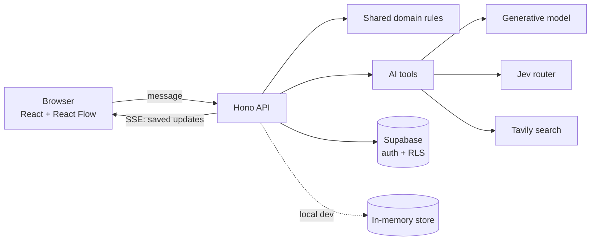

<p align="center">
  <picture>
    <source media="(prefers-color-scheme: dark)" srcset="docs/assets/banner-dark.png">
    
  </picture>
</p>

<p align="center">
  <a href="#getting-started">Getting started</a> ·
  <a href="#usage">Usage</a> ·
  <a href="README.pt-BR.md">Português</a>
</p>

<p align="center">
  <a href="LICENSE"></a>
  
  
  
</p>

<p align="center">
  
</p>

**From a business idea to its first real evidence, one small test at a time.**

create is a copilot for people starting their first business, in Brazilian Portuguese. You tell it your idea; a short interview turns it into a visual plan of cards and points to one thing to do now. Then you run that test in the real world, come back with what happened, and the plan proposes a revision you can accept or reject.

Start small, learn for real. Hypotheses, research and evidence keep their origin, and a ticked checklist is never treated as proof that people want what you are building.

## Features

- **From conversation to canvas.** The chat asks one question at a time and adds cards to an editable canvas while it works; each card is saved before it appears.
- **One next step.** At most one action sits in *Agora* (Now), and prerequisite links between cards reject cycles and duplicates.
- **Your edits stay.** Titles, blocks, checklists, positions and links you change are preserved; AI changes that would overwrite them become proposals.
- **Research with sources.** Optional web search adds links, excerpts and consultation dates. When search is off, the app says so instead of inventing results.
- **Learn from real tests.** Log what happened and compare the proposed revision side by side before applying it.
- **No sign-up.** Projects belong to an anonymous browser session (up to three), with JSON export and import.

## Getting started

> [!NOTE]
> You need **Node.js 24** and npm. No API keys are required to try it locally: without them, projects are kept in memory and the assistant runs in a basic guided mode, clearly labeled as such. The interface is in Brazilian Portuguese.

```bash
git clone https://github.com/PHMFG/create-dia-zero.git
cd create-dia-zero
npm ci
cp .env.example .env.local
npm run dev
```

Open http://127.0.0.1:5173. The same process serves the Vite frontend and the Hono API; restart it after changing backend code.

```bash
npm test
npm run typecheck
npm run build
```

<details>
<summary><strong>Optional configuration</strong></summary>
<br>

Add keys to `.env.local` to turn on each service. They are read by the server only.

| Variables | What they enable |
| --- | --- |
| `SUPABASE_URL`, `SUPABASE_PUBLISHABLE_KEY` | Persistent projects with anonymous auth and row-level security. Required in production. |
| `OPENCODE_GO_API_KEY`, `OPENCODE_MODEL`, `OPENCODE_BASE_URL` | Generated replies through an OpenAI-compatible endpoint (OpenCode Go by default). |
| `TYPESAFE_API_KEY`, `TYPESAFE_MODEL` | Message routing with Jev; simple rules are used without it. |
| `TAVILY_API_KEY` | Web research. |

To use your own Supabase project, apply `supabase/schema.sql` and then `supabase/cancellation.sql`, enable **Anonymous Sign-Ins** under *Authentication → Sign In / Providers*, and keep the `private` schema out of the Data API. `vercel.json` deploys the static build together with the API as a Node.js function.

</details>

## Usage

1. Run `npm run dev` and open the app.
2. Click **Explore um projeto de exemplo** to open *Chabor*, a fictional matcha brand used as a guided demo, or type an idea such as *“Quero abrir uma cafeteria diferente na minha cidade.”*
3. On the canvas, the **Agora** card is your next step. Tick its checklist, open **Sobre** for the full card, or use the chat bubble to ask a question about that card.
4. After running the test for real, click **Experiência**, describe what you observed and review the proposed revision.

<p align="center">
  
</p>

## Screens

<details>
<summary><strong>Show the gallery</strong></summary>
<br>

<p align="center">
  <br>
  <em>Start from an idea or open the example project.</em>
</p>

<p align="center">
  <br>
  <em>Each card has a view, an editor and a history.</em>
</p>

<p align="center">
  <br>
  <em>Logging an experience leads to a proposal you can apply or reject. Captured in the offline guided mode, which says so.</em>
</p>

<p align="center">
  <br>
  <em>On small screens, the conversation and the plan become tabs.</em>
</p>

</details>

## How it works



During a reply, the model can read the project, search, calculate and publish cards. The API checks every change against the shared domain rules and saves it with a version check before streaming it to the browser, which merges it with edits you have not saved yet. Stopping a reply is an explicit, durable request, so it also works behind a proxy. The [architecture page](wiki/architecture.md) of the wiki has the details (in Portuguese).

## Roadmap

- [x] Conversation that builds an editable canvas with seven card types
- [x] Cards published one by one over SSE, each saved before it is shown
- [x] Human edits preserved, with conflicts turned into proposals
- [x] Web research with sources and consultation dates
- [x] Experience logging and revision proposals
- [x] Anonymous sessions with row-level security, plus JSON export and import
- [x] Offline guided mode and the Chabor demo project
- [ ] Public demo back online (the deployment is paused)
- [ ] Move projects between devices without exporting a file
- [ ] Verify bot-protection tokens on the API
- [ ] English interface
- [ ] Continuous integration running the tests on Node.js 24

## Documentation

The [project wiki](wiki/index.md) covers product, architecture, domain, AI, research, persistence, security and operations, and [AGENTS.md](AGENTS.md) explains how to continue development. Both are in Portuguese. Earlier verification reports are in [`docs/`](docs/).

## License and credits

The code is released under the [MIT License](LICENSE). The create wordmark, the spark symbol and the images in [`docs/assets/`](docs/assets/) were made for this project; the screenshots show only fictional demo data.

Built with open-source software, each under its own license:

- [Inter](https://github.com/rsms/inter) typeface via Fontsource — SIL Open Font License 1.1
- [Lucide](https://lucide.dev) icons — ISC
- [React](https://react.dev), [React Flow](https://reactflow.dev), [Motion](https://motion.dev), [react-markdown](https://github.com/remarkjs/react-markdown), [Vite](https://vite.dev), [Hono](https://hono.dev), [Zod](https://zod.dev), [Supabase JS](https://github.com/supabase/supabase-js), [TypeSafe SDK](https://www.npmjs.com/package/@typesafe-ai/sdk) — MIT
- [AI SDK](https://ai-sdk.dev) and its OpenAI-compatible provider, [TypeScript](https://www.typescriptlang.org), [Playwright](https://playwright.dev) — Apache 2.0
- [Vitest](https://vitest.dev), [esbuild](https://esbuild.github.io), [tsx](https://tsx.is) — MIT; [dotenv](https://github.com/motdotla/dotenv) — BSD 2-Clause

The optional services (OpenCode Go, Jev, Tavily, Supabase and Vercel) are not bundled and follow their own terms.
