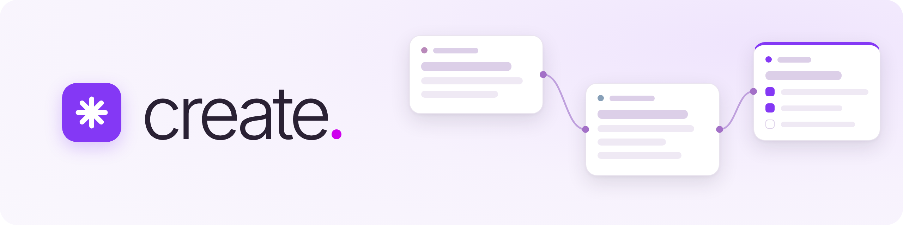
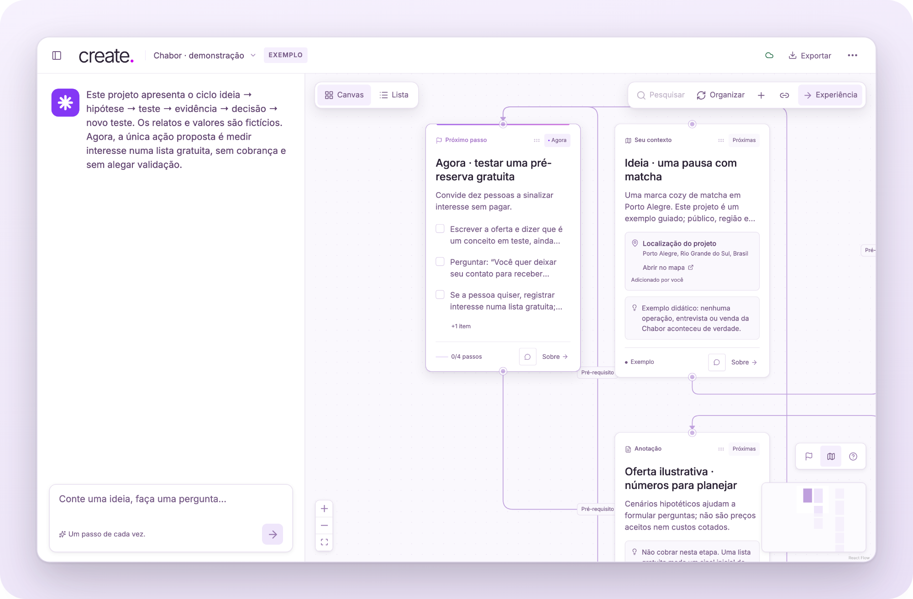
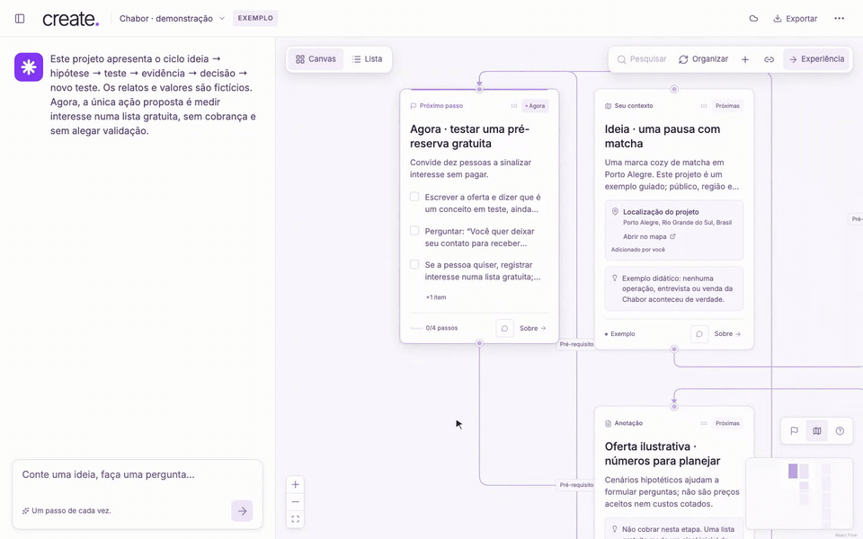
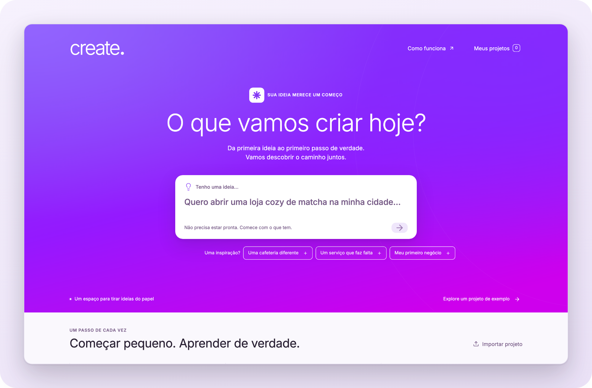
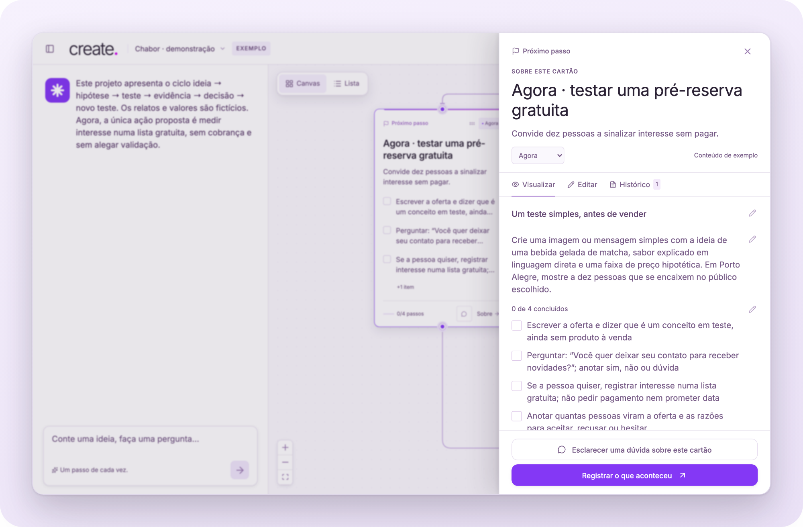
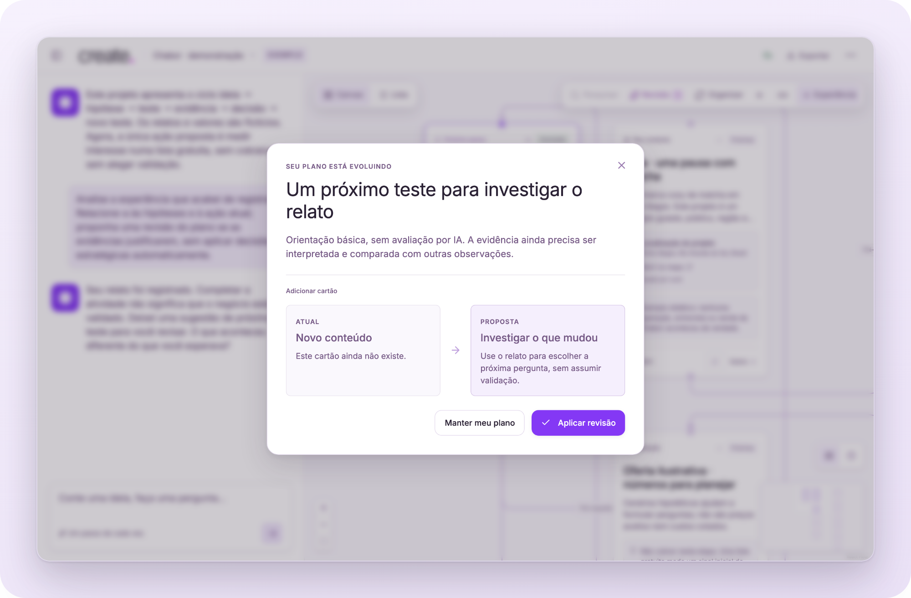
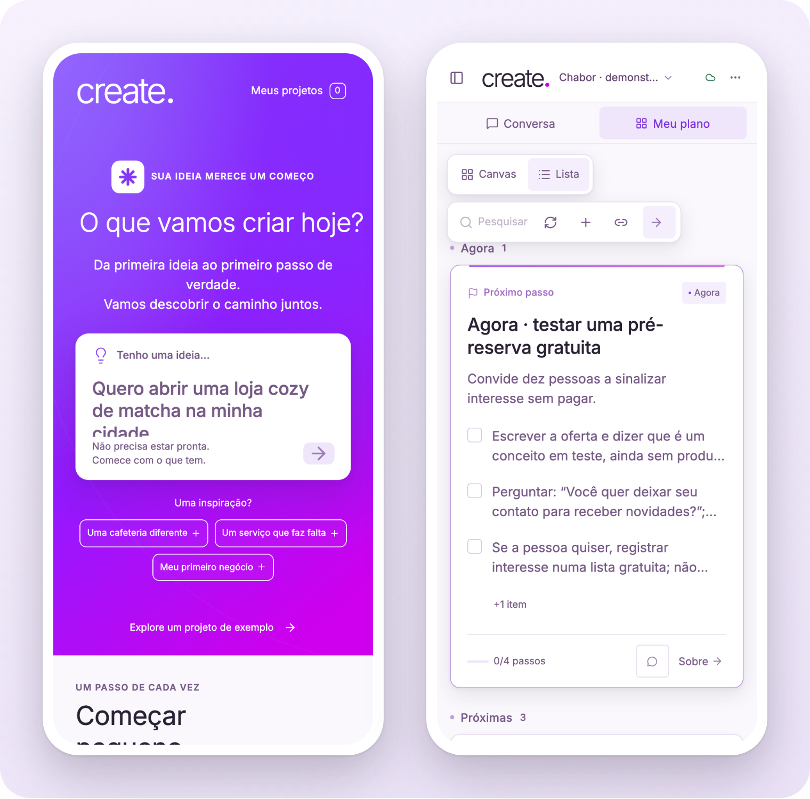
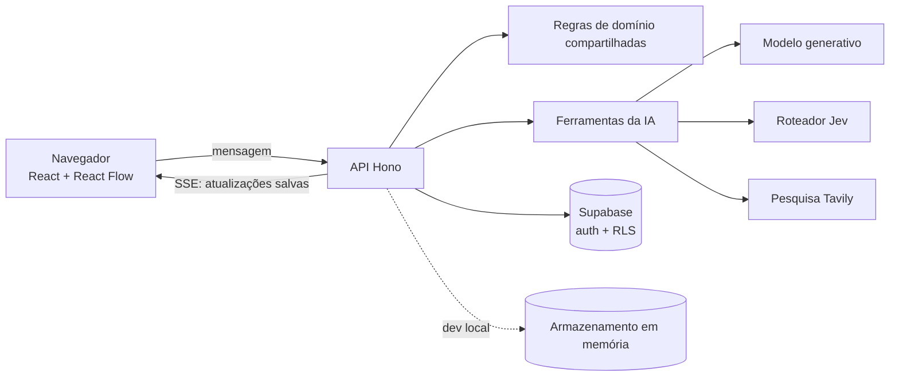

<p align="center">
  <picture>
    <source media="(prefers-color-scheme: dark)" srcset="docs/assets/banner-dark.png">
    
  </picture>
</p>

<p align="center">
  <a href="#como-rodar">Como rodar</a> ·
  <a href="#uso">Uso</a> ·
  <a href="README.md">English</a>
</p>

<p align="center">
  <a href="LICENSE"></a>
  
  
  
</p>

<p align="center">
  
</p>

**Da ideia de negócio à primeira evidência real, um pequeno teste de cada vez.**

A create é um copiloto em português para quem está começando o primeiro negócio. Você conta sua ideia; uma conversa curta a transforma num plano visual de cartões e aponta uma coisa para fazer agora. Depois, você faz esse teste no mundo real, volta com o que aconteceu, e o plano propõe uma revisão que você pode aceitar ou recusar.

Começar pequeno, aprender de verdade. Hipóteses, pesquisa e evidências mantêm sua origem, e uma checklist marcada nunca é tratada como prova de que as pessoas querem o que você está criando.

## Recursos

- **Da conversa ao canvas.** O chat faz uma pergunta por vez e adiciona cartões a um canvas editável enquanto trabalha; cada cartão é salvo antes de aparecer.
- **Um próximo passo.** No máximo uma ação fica em *Agora*, e as ligações de pré-requisito entre cartões recusam ciclos e duplicatas.
- **Suas edições ficam.** Títulos, blocos, checklists, posições e ligações que você muda são preservados; mudanças da IA que os sobrescreveriam viram propostas.
- **Pesquisa com fontes.** A pesquisa web opcional acrescenta links, trechos e datas de consulta. Sem pesquisa configurada, o app avisa em vez de inventar resultados.
- **Aprender com testes reais.** Registre o que aconteceu e compare lado a lado a revisão proposta antes de aplicá-la.
- **Sem cadastro.** Os projetos pertencem a uma sessão anônima do navegador (até três), com exportação e importação em JSON.

## Como rodar

> [!NOTE]
> Você precisa do **Node.js 24** e do npm. Nenhuma chave de API é necessária para experimentar localmente: sem elas, os projetos ficam na memória e o assistente funciona em um modo de orientação básica, identificado como tal. A interface é em português do Brasil.

```bash
git clone https://github.com/PHMFG/create-dia-zero.git
cd create-dia-zero
npm ci
cp .env.example .env.local
npm run dev
```

Abra http://127.0.0.1:5173. O mesmo processo serve o frontend Vite e a API Hono; reinicie-o depois de alterar o código do backend.

```bash
npm test
npm run typecheck
npm run build
```

<details>
<summary><strong>Configuração opcional</strong></summary>
<br>

Acrescente as chaves ao `.env.local` para ligar cada serviço. Elas são lidas apenas pelo servidor.

| Variáveis | O que habilitam |
| --- | --- |
| `SUPABASE_URL`, `SUPABASE_PUBLISHABLE_KEY` | Projetos persistentes com autenticação anônima e segurança por linha (RLS). Obrigatórias em produção. |
| `OPENCODE_GO_API_KEY`, `OPENCODE_MODEL`, `OPENCODE_BASE_URL` | Respostas geradas por um endpoint compatível com OpenAI (OpenCode Go por padrão). |
| `TYPESAFE_API_KEY`, `TYPESAFE_MODEL` | Roteamento das mensagens com o Jev; sem ele, o app usa regras simples. |
| `TAVILY_API_KEY` | Pesquisa web. |

Para usar seu próprio projeto Supabase, aplique `supabase/schema.sql` e depois `supabase/cancellation.sql`, habilite **Anonymous Sign-Ins** em *Authentication → Sign In / Providers* e mantenha o schema `private` fora da Data API. O `vercel.json` publica o build estático junto com a API como uma função Node.js.

</details>

## Uso

1. Rode `npm run dev` e abra o app.
2. Clique em **Explore um projeto de exemplo** para abrir a *Chabor*, uma marca fictícia de matcha usada como demonstração guiada, ou escreva uma ideia como *“Quero abrir uma cafeteria diferente na minha cidade.”*
3. No canvas, o cartão **Agora** é o seu próximo passo. Marque a checklist, abra **Sobre** para ver o cartão completo ou use o balão de conversa para fazer uma pergunta sobre aquele cartão.
4. Depois de fazer o teste de verdade, clique em **Experiência**, descreva o que você observou e avalie a revisão proposta.

<p align="center">
  
</p>

## Telas

<details>
<summary><strong>Ver a galeria</strong></summary>
<br>

<p align="center">
  <br>
  <em>Comece por uma ideia ou abra o projeto de exemplo.</em>
</p>

<p align="center">
  <br>
  <em>Cada cartão tem visualização, editor e histórico.</em>
</p>

<p align="center">
  <br>
  <em>Registrar uma experiência leva a uma proposta que você pode aplicar ou recusar. Captura feita no modo de orientação básica, que se identifica como tal.</em>
</p>

<p align="center">
  <br>
  <em>Em telas pequenas, a conversa e o plano viram abas.</em>
</p>

</details>

## Como funciona



Durante uma resposta, o modelo pode ler o projeto, pesquisar, calcular e publicar cartões. A API confere cada mudança com as regras de domínio compartilhadas e a salva com verificação de versão antes de enviá-la ao navegador, que a mescla com as edições que você ainda não salvou. Interromper uma resposta é um pedido explícito e durável, por isso funciona também atrás de um proxy. A [página de arquitetura](wiki/architecture.md) da wiki tem os detalhes.

## Roadmap

- [x] Conversa que monta um canvas editável com sete tipos de cartão
- [x] Cartões publicados um a um por SSE, cada um salvo antes de aparecer
- [x] Edições humanas preservadas, com conflitos transformados em propostas
- [x] Pesquisa web com fontes e datas de consulta
- [x] Registro de experiências e propostas de revisão
- [x] Sessões anônimas com segurança por linha, além de exportação e importação em JSON
- [x] Modo de orientação básica sem chaves e o projeto de demonstração Chabor
- [ ] Demo pública de volta ao ar (a publicação está pausada)
- [ ] Levar projetos entre dispositivos sem exportar um arquivo
- [ ] Verificar tokens de proteção contra bots na API
- [ ] Interface em inglês
- [ ] Integração contínua rodando os testes no Node.js 24

## Documentação

A [wiki do projeto](wiki/index.md) cobre produto, arquitetura, domínio, IA, pesquisa, persistência, segurança e operação, e o [AGENTS.md](AGENTS.md) explica como continuar o desenvolvimento. Relatórios de verificações anteriores estão em [`docs/`](docs/).

## Licença e créditos

O código é distribuído sob a [Licença MIT](LICENSE). O logotipo create, o símbolo spark e as imagens em [`docs/assets/`](docs/assets/) foram feitos para este projeto; as capturas mostram apenas dados fictícios de demonstração.

Feito com software de código aberto, cada um com sua licença:

- Fonte [Inter](https://github.com/rsms/inter) via Fontsource — SIL Open Font License 1.1
- Ícones [Lucide](https://lucide.dev) — ISC
- [React](https://react.dev), [React Flow](https://reactflow.dev), [Motion](https://motion.dev), [react-markdown](https://github.com/remarkjs/react-markdown), [Vite](https://vite.dev), [Hono](https://hono.dev), [Zod](https://zod.dev), [Supabase JS](https://github.com/supabase/supabase-js), [TypeSafe SDK](https://www.npmjs.com/package/@typesafe-ai/sdk) — MIT
- [AI SDK](https://ai-sdk.dev) e seu provedor compatível com OpenAI, [TypeScript](https://www.typescriptlang.org), [Playwright](https://playwright.dev) — Apache 2.0
- [Vitest](https://vitest.dev), [esbuild](https://esbuild.github.io), [tsx](https://tsx.is) — MIT; [dotenv](https://github.com/motdotla/dotenv) — BSD 2-Clause

Os serviços opcionais (OpenCode Go, Jev, Tavily, Supabase e Vercel) não fazem parte do pacote e seguem os próprios termos.
