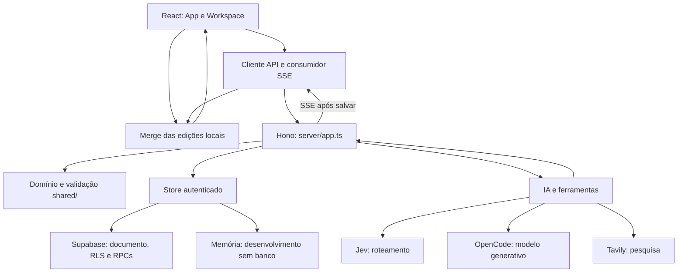

# Arquitetura da create

A aplicação usa um documento `Project` como estado central. O navegador permite edição imediata; a API aplica regras do domínio e salva versões condicionais; IA e pesquisa produzem alterações validadas nesse mesmo documento. O objetivo é manter o plano utilizável durante a conversa e preservar decisões humanas.

## Camadas e dependências

| Camada | Responsabilidade | Detalhes |
| --- | --- | --- |
| `src/` | Leitura e edição, foco, autosave, fila e apresentação. | [Frontend](frontend.md), [canvas](canvas.md), [design](design-system.md). |
| `shared/` | Tipos, validação, invariantes, propostas, evidências e normalização. | [Domínio](domain.md). |
| `server/app.ts` | Contratos HTTP, sessão, ciclo da mensagem, SSE e coordenação de gravações. | [Backend](backend.md). |
| `server/ai.ts` e `prompts.ts` | Roteamento, contexto limitado, ferramentas, sanitização e publicações. | [IA](ai.md). |
| `server/research.ts` | Busca e extração externas com procedência. | [Pesquisa](research.md). |
| `server/store.ts` e `supabase/` | Autoria, CAS, cotas, exclusão mútua e cancelamento durável. | [Persistência](persistence.md), [segurança](security.md). |

## Caminho de uma conversa

O cliente envia a mensagem com a sessão, o projeto e um `runId`. A API verifica autoria, reserva uma execução e salva a mensagem do usuário antes da inferência. Durante a geração, ferramentas podem enviar `CanvasDelta`; a API relê o estado atual, aplica o domínio e salva com a versão observada. Só então emite `project` com o documento e os cartões afetados.

O cliente usa `mergeIncoming(base, local, incoming)` para incorporar a atualização sem perder alterações locais ainda não salvas. O servidor protege conteúdo humano e separa conflitos em propostas. Esses são mecanismos complementares: merge no navegador não substitui CAS no armazenamento nem a validação de revisões no domínio.

Atividades públicas descrevem ações da ferramenta; chunks de texto expõem a resposta, não argumentos internos ou raciocínio. Ao terminar, o evento `complete` entrega a versão final persistida. O ledger da IA reconhece operações já publicadas para impedir reaplicação na resposta final. Consulte [backend](backend.md) e [IA](ai.md).

## Edição fora da geração

O workspace mantém estado local e um baseline sincronizado. O autosave manda cartões/contexto para a API, que aplica `applyHumanEdit` e incrementa o documento antes da gravação condicional. Uma mudança de versão pode retornar conflito; a interface mantém texto local para recuperação. Evidência e resolução de proposta têm endpoints próprios e também usam a versão observada.

`Project.version` protege o documento armazenado. `CanvasCard.revision` protege alvos de operações e propostas. São granularidades diferentes; veja [domínio](domain.md), [frontend](frontend.md) e [persistência](persistence.md).

## Interrupção e fila

O pedido explícito de cancelamento é autenticado e usa o mesmo `runId`. No Supabase, um marcador durável permite que a função observe a interrupção mesmo quando o proxy mantém a conexão com o backend. A API espera as gravações iniciadas e encerra a reserva antes de liberar outra execução. O navegador pausa a fila durante cancelamentos ou falhas e só retoma após o encerramento pertinente.

Os itens da fila vivem no navegador e sobrevivem ao reload em `sessionStorage`, retomados pausados. A trava de execução vive no servidor/banco. Não há um worker distribuído para essa fila. [Frontend](frontend.md) e [persistência](persistence.md) explicam os dois contratos.

## Desenvolvimento e produção

`server/dev.ts` carrega `.env.local`, inicia Hono na porta 5173 e incorpora o middleware Vite. Frontend e API usam a mesma origem local. Em produção, `scripts/build-api.mjs` empacota `server/vercel.ts` em `.server/api.mjs`; `api/index.mjs` expõe o handler e `vercel.json` configura SPA e roteamento da função.

`dist/` e `.server/` são saídas de build, não fontes editáveis. A extração `.design-export/` usa um cenário separado com mocks e cópias de componentes; não participa desse caminho ativo. Consulte [operação](operations.md) e [design](design-system.md).

Volte ao [índice](index.md) ou leia as [decisões](decisions.md) e os [limites verificados](risks.md).
